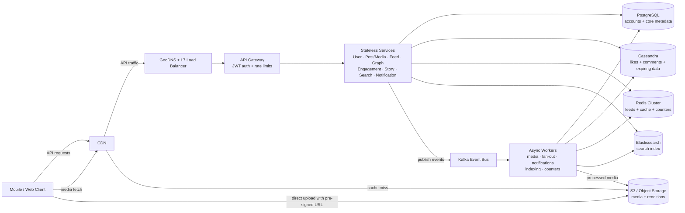
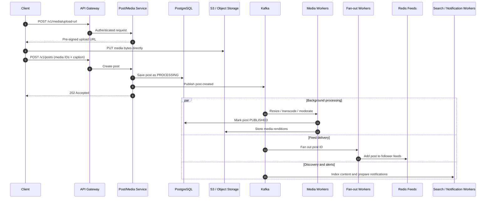
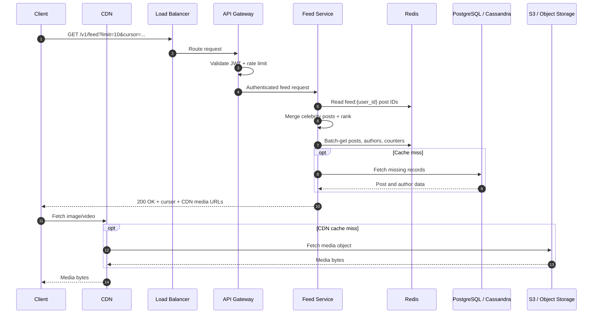
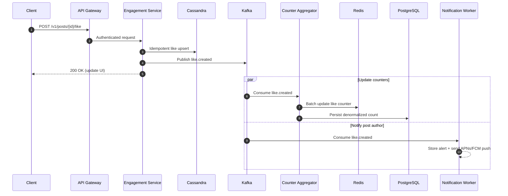

[https://instagram-flow-explorer-vje2.arcada.app](https://instagram-flow-explorer-vje2.arcada.app)

# Instagram System Design

A system design for a large-scale Instagram-style social media platform. The design covers photo and video publishing, personalized feeds, social graph operations, engagement, stories, search, and notifications.

> **Interactive architecture:** [Open the live Instagram Flow Explorer](https://instagram-flow-explorer-vje2.arcada.app) to watch request packets move through the system blocks across different scenarios.
>
> **Full design document:** [Instagram System Design Document (PDF)](./Instagram_System_Design_Document.pdf) — place the PDF in the repository root for this link to work.

## Architecture at a Glance

The platform is organized into five layers. Synchronous requests handle user-facing operations, while Kafka and background workers take care of work that can finish after the API responds.



### Main Components

| Layer | Components | Responsibility |
| --- | --- | --- |
| Client | Mobile app, web app | Sends API calls, uploads media, and renders feeds and profiles. |
| Edge | CDN, GeoDNS, load balancer, API gateway | Delivers cached media, routes traffic, validates JWTs, and enforces rate limits. |
| Services | User, Post/Media, Feed, Graph, Engagement, Story, Search, Notification | Own focused product capabilities and coordinate data access. |
| Data | PostgreSQL, Cassandra, Redis, Elasticsearch, S3 | Stores relational records, high-volume activity, hot cache data, search indexes, and media. |
| Async processing | Kafka and worker pools | Buffers traffic spikes and decouples slow processing from API latency. |

## Request Flows

### 1. Upload a photo or video

Media bytes go directly from the client to object storage. The API acknowledges post creation before slower processing is complete.



**Key behavior:** app servers do not carry large media uploads. Standard accounts use push fan-out after publishing; celebrity posts are merged into feeds at read time to avoid millions of write operations.

### 2. Open the home feed

The feed service reads precomputed post IDs, merges recent posts from high-follower accounts, ranks the results, then hydrates them with cached post and profile data.



### 3. Like a post

The like record is written idempotently and acknowledged quickly. Kafka consumers update counters and deliver notifications asynchronously.



### Other documented cases

- **Follow a public account:** update the follow graph and return `FOLLOWING`.
- **Follow a private account:** create a follow request and return `REQUESTED`; privacy checks use a strongly consistent source.
- **Search:** query Elasticsearch; indexing from new posts and users is asynchronous, so results can lag briefly.
- **Stories:** serve a story tray and expire story records after 24 hours using TTL-backed storage.
- **Comments:** persist the comment, return an acknowledgement, and process counters and notifications asynchronously.
- **Failures and fallbacks:** use a chronological feed if ranking is unavailable, rebuild or serve a stale feed on cache misses, and keep search/notifications isolated from core posting and feed paths.

## Data and Scaling Choices

| Data / workload | Store or approach | Reason |
| --- | --- | --- |
| Accounts, posts, and follow graph | PostgreSQL | Transactions, uniqueness constraints, and strong consistency for core records and privacy. |
| Likes and comments | Cassandra | High-volume, append-heavy access patterns partitioned by post or user. |
| Feeds, sessions, hot objects, counters | Redis | Low-latency reads and sorted sets for feed timelines. |
| Photos and videos | S3-compatible object storage + CDN | Durable, scalable media storage with edge delivery and direct uploads. |
| Search | Elasticsearch | Full-text and prefix search for users and hashtags. |
| Background work | Kafka + idempotent consumers | Buffers traffic spikes and decouples slow processing from API latency. |
| Feed fan-out | Hybrid push/pull | Push posts to regular followers; merge celebrity posts during feed reads. |

The design uses cursor pagination, read replicas, sharding, cache-aside behavior, and read-your-writes routing where needed. Accounts, credentials, and privacy operations favor strong consistency; feeds, counters, search, and notifications can converge asynchronously.

## Design Targets in the Document

These are assumptions and targets from the accompanying system design, not measurements of a production Instagram deployment.

- **Scale assumption:** 1 billion monthly active users and 500 million daily active users.
- **Feed API latency:** p99 below 200 ms; first image target below 1 second.
- **Availability target:** 99.99% for feed and read paths; 99.9% for uploads.
- **Traffic estimate:** about 250,000 average requests per second and 750,000 at peak.
- **Media strategy:** CDN delivery for more than 95% of media requests, with media uploaded directly to object storage.

## API Examples

The design proposes REST over HTTPS with JSON, JWT bearer authentication, idempotency keys for write retries, and cursor pagination for lists.

| Method | Endpoint | Purpose |
| --- | --- | --- |
| `POST` | `/v1/auth/signup`, `/v1/auth/login` | Account creation and login |
| `GET` | `/v1/users/{id}` | Profile |
| `POST` / `DELETE` | `/v1/users/{id}/follow` | Follow or unfollow |
| `POST` | `/v1/media/upload-url` | Request a pre-signed media upload URL |
| `POST` | `/v1/posts` | Create a post |
| `GET` | `/v1/feed` | Read a paginated home feed |
| `POST` / `DELETE` | `/v1/posts/{id}/like` | Like or unlike a post |
| `POST` / `GET` | `/v1/posts/{id}/comments` | Add or list comments |
| `GET` | `/v1/search` | Search users or tags (`type=user` or `type=tag`) |
| `GET` | `/v1/notifications` | List notifications |

## Repository Contents

```text
.
├── README.md
└── Instagram_System_Design_Document.pdf
```

Keep the PDF beside this README in the repository root, or update the relative PDF link above if you store it in a folder such as `docs/`.

## Contributors

- Anmol Sahu
- Gaurav Jangid
- Maulik Sharma
- Suryaansh Sharma

Prepared for the System Design and DevOps assignment at the Institute of Engineering and Technology, JK Lakshmipat University, Jaipur.
